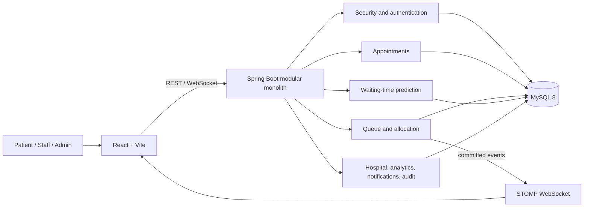
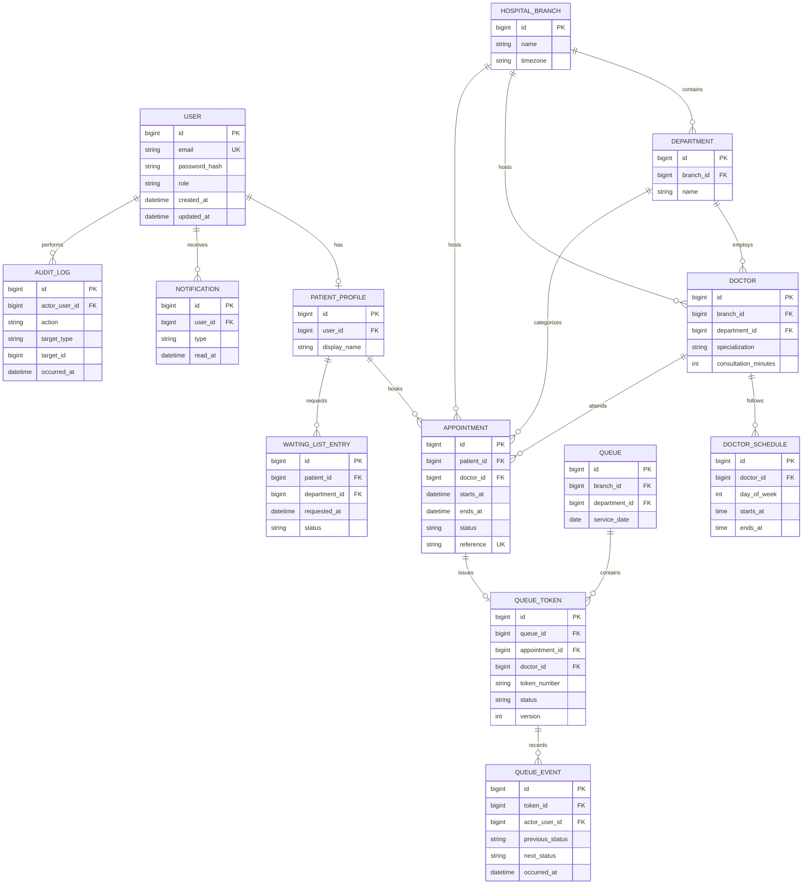

# QueueLess AI

QueueLess AI is a hospital appointment and queue-management application, built incrementally as a modular monolith. This document distinguishes the proposed architecture and roadmap from the functionality currently implemented.

## Architecture proposal



The backend is organized by business capability rather than deployed as multiple services. Controllers accept and validate DTOs; services own business rules and transactions; repositories persist entities. MySQL remains the source of truth. Flyway will version schema changes. The UI communicates through versionable REST endpoints and receives non-sensitive queue snapshots/updates over authenticated WebSockets.

### Main database relationships



Important modeling decisions:

- `USER` stores login identity and role; patient-only profile data is separate. Staff and doctors have their own domain records/assignments.
- Appointments reference patient, doctor, branch, and department; a unique doctor/time-slot constraint plus a transactional lock prevents double booking.
- A `QUEUE` is scoped to branch, department, and service date. A token references the queue and optionally the appointment and assigned doctor. A unique queue/token-number constraint prevents duplicate human-readable tokens.
- `QUEUE_EVENT` is the immutable transition history; `AUDIT_LOG` captures privileged business actions and overrides. Current token status remains queryable without replaying the event stream.
- `version` supports optimistic locking on queue tokens. Critical “call next” selection will additionally use a database transaction and pessimistic row locking so simultaneous staff actions cannot select the same waiting token.
- The final schema and constraints will be introduced through Flyway migrations as domain modules are implemented.

## Appointment and queue workflows

### Appointment booking

1. The patient selects branch, department, doctor, and an offered slot.
2. The API validates the patient and slot, branch/department/doctor compatibility, schedule, operating hours, and booking/cancellation policy.
3. In one database transaction, the service locks the doctor row, validates the requested slot in the branch time zone, checks for an existing active booking, and writes the appointment. A unique active-slot constraint is the final defense against races.
4. Booking returns a unique appointment reference. A queue token is not created until an authorized staff member checks the patient in, beginning 60 minutes before the appointment through its scheduled end.
5. Check-in locks the appointment and service queue, allocates a persisted queue token, and records the appointment as `CHECKED_IN`. Queue sequence allocation is serialized on the MySQL queue row.
6. Cancellation is restricted to the appointment owner and requires at least two hours' notice. Cancelled appointments release their time slot.

### Queue state and staff actions

Allowed forward transitions are `WAITING -> CALLED -> IN_SERVICE -> COMPLETED`. A waiting or called token may transition to `SKIPPED`, `NO_SHOW`, or `CANCELLED` only under policy and with an audit event. A skipped token may be recalled to `CALLED` by authorized staff. Other transitions are rejected rather than silently coerced.

“Call next” locks the service queue before selecting the first eligible `WAITING` token, then records the transition and event in one transaction. Competing calls serialize on the queue row and cannot call the same token twice. WebSocket updates are published after transaction commit and contain no patient identifiers; patients receive updates only on their authenticated user destination. Every page can recover from disconnects by fetching a fresh REST snapshot.

### Explainable doctor allocation

First filter doctors by branch, department/specialty, working schedule, active availability, capacity, and compatibility with existing appointment commitments. Never allocate to an unavailable/ineligible doctor. For each eligible doctor calculate:

`projected_load = remaining_work_minutes + waiting_work_minutes + appointment_commitment_minutes`

Remaining/current work uses the configured service duration until enough real consultation-duration observations exist; thereafter a bounded historical average can be used. Appointment commitments are the expected work scheduled before the candidate can start. Select the eligible doctor with the lowest projected load, with stable doctor-ID tie-breaking. Persist the selected doctor and a short decision reason. Authorized manual overrides require a reason and audit record. Re-evaluation only affects waiting patients, never a patient already in service.

### Initial waiting-time estimate

The initial model is a transparent calculation, not a trained or accuracy-validated AI model. For a patient in a doctor-specific lane:

`estimated_wait_minutes = remaining_current_consultation + expected_minutes_for_waiting_or_called_patients_ahead`

The estimator uses up to 20 recent completed consultations for the assigned doctor, or the doctor's configured consultation duration as a fallback. It includes the current consultation's remaining time, counts only eligible patients ahead in that doctor's lane, clamps negative values to zero, and returns an approximate range with confidence and an arrival-time estimate in the branch time zone. Updates are recalculated from persisted queue state; queue changes are sent to the patient's private WebSocket destination and REST polling runs every 20 seconds as a fallback. This is a calculation-based estimate, not AI or a guaranteed consultation time.

## UI page structure

- **Public:** landing page, login, registration, branch/department discovery, doctor directory/details, appointment booking, about/FAQ.
- **Patient shell:** overview, appointments/history, appointment details, live queue tracker, notifications, profile.
- **Staff shell:** queue overview and controls, authorized patient-token details, workload.
- **Admin shell:** operations overview/analytics, branches, departments, doctors, staff, queue policies, audit logs.

Shared responsive navigation, role-protected routes, cards, tables, dialogs, forms, notifications, loading skeletons, and empty/error states will be introduced with the UI phase. 3D rendering is limited to the public hero, dynamically loaded with a reduced-motion/static fallback; dashboards remain lightweight.

## Development phases and acceptance criteria

1. **Requirements/design:** domain boundaries, relationships, transition rules, allocation and estimate assumptions, UI map. Acceptance: documented diagrams and rules; no claim of unimplemented functionality.
2. **Project foundation:** React/Vite, Spring Boot 3, MySQL configuration, environment placeholders, local containers. Acceptance: frontend production build succeeds; backend compiles; health endpoint responds; database is health-checked in Compose.
3. **UI foundation:** visual system, responsive landing/auth shells, reusable states/components. Acceptance: keyboard-accessible routes and forms; build/lint and focused UI tests pass.
4. **Security and core domain:** password hashing/JWT/authorization, migrations, catalog, appointment, queue/token services. Acceptance: server-side validation and ownership checks, concurrency-safe booking/queue actions, automated unit/integration tests.
5. **Operations and intelligence:** allocation, explainable prediction, WebSockets, notification, analytics/admin/staff flows. Acceptance: allocation/prediction behavior tested; authenticated least-privilege subscriptions; analytics use database-backed denominators.
6. **Release readiness:** broader tests, Docker setup, Postman/API docs, security and setup documentation. Acceptance: clean local startup instructions verified; checks reported truthfully; limitations documented.

## Current implementation status

The current application includes a responsive React/Vite frontend and a Spring Boot API backed by MySQL and Flyway. Patients can discover doctors, book and cancel their own appointments, and review appointment history. Reception staff can check in eligible appointments and issue persisted tokens; patients can follow token status, their doctor-specific place in line, the currently serving token, and an approximate wait. Staff can call, start, and complete consultations; completed service durations contribute to future estimates. Queue updates use authenticated WebSockets with 20-second REST refresh as a fallback. Existing registration, notifications, waiting-list, analytics, and admin management flows remain available.

Flyway V13 adds the checked-in appointment state, cancellable-slot uniqueness, and consultation timestamps; V14 initializes persisted per-queue token sequencing. Automated tests cover successful and invalid booking, cancellation policy, check-in eligibility/token creation, patients-ahead and wait calculations, call-once behavior, consultation timestamps, existing staff assignment checks, health, and waiting lists. These tests are unit/controller-level; a production-readiness effort should still add database-backed concurrency, migration-upgrade, WebSocket integration, and broader authorization tests.

Known gaps: administrator setup is available only after an operator configures a private one-time bootstrap token; there is no password-reset or external email/SMS delivery flow. Staff accounts are restricted to one assigned branch/department, and the staff queue currently represents a department service lane rather than separately managed doctor workstations. Queue updates use Spring's in-memory simple broker and are not horizontally scalable. The test suite does not yet exercise true parallel database races or end-to-end WebSocket delivery. Review and complete the release-readiness checklist below before production use.

## Local development

Prerequisites: Node.js 22+, Java 21+, Maven 3.9+, and a running MySQL 8 instance. Docker Compose is optional if you prefer the containerized setup.

1. Copy `.env.example` to `.env`, then set `MYSQL_DATABASE`, `MYSQL_USER`, `MYSQL_PASSWORD`, `JWT_SECRET`, and any applicable host/port values for your local MySQL server. The MySQL account must have permission to create/alter tables in the selected database. `JWT_SECRET` must be at least 32 random bytes encoded as hexadecimal. Do not share or commit `.env`.
2. To run directly against local MySQL, start the backend from a PowerShell terminal with `.\backend\run-local.ps1`. It reads `.env` without printing its values and starts the API on port `8081`.
3. In a second terminal, start the frontend with `.\frontend\run-local.ps1`. Open `http://127.0.0.1:5174`; it checks the API at `http://127.0.0.1:8081/api/health`.
4. To run the Docker stack instead, start Docker Desktop, then run `docker compose up --build`. Open the frontend at `http://localhost:5173`; the API listens on `http://localhost:8080` and MySQL on `localhost:3306`.

The example values are placeholders for local development only. Replace them before starting; do not reuse them in production or commit real secrets.

### First administrator setup

Admin creation is intentionally disabled unless `ADMIN_BOOTSTRAP_TOKEN` is configured, and the bootstrap endpoint permits only the first admin. Generate a private, random token locally and add it to `.env` without printing it:

```powershell
$bytes = New-Object byte[] 32
[Security.Cryptography.RandomNumberGenerator]::Fill($bytes)
$token = [Convert]::ToHexString($bytes)
Add-Content -Path .env -Value "ADMIN_BOOTSTRAP_TOKEN=$token"
Remove-Variable token, bytes
```

Restart the backend, open `http://127.0.0.1:5174/setup-admin`, and enter that token with the admin email and a strong password (at least 12 characters). The token is no longer accepted after the first administrator exists; remove its `.env` entry and restart the backend afterward. Do not put this endpoint or token on a public production network; provision the first administrator through a controlled deployment process instead.
